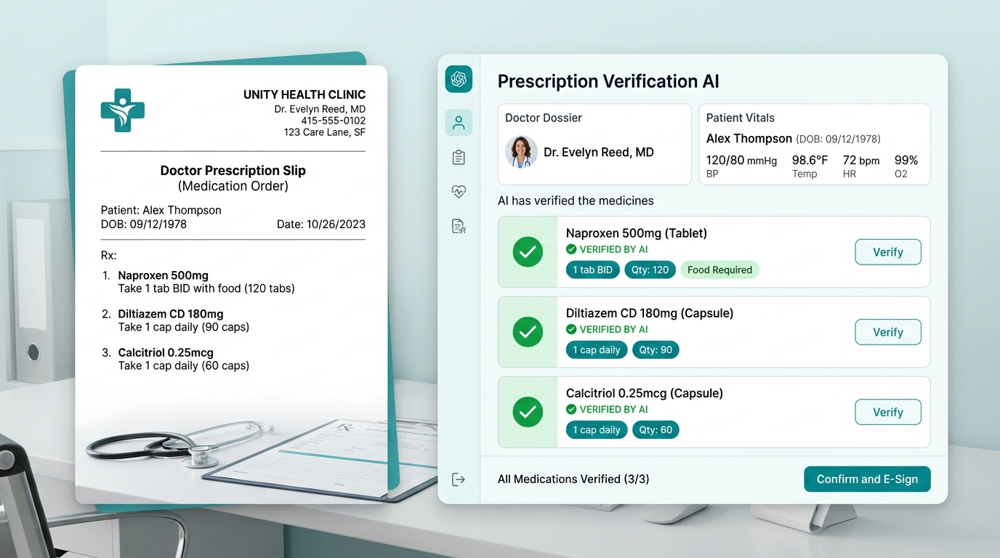
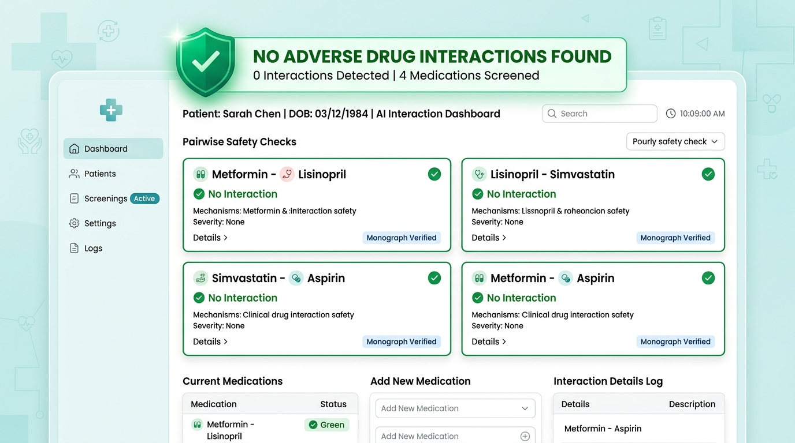
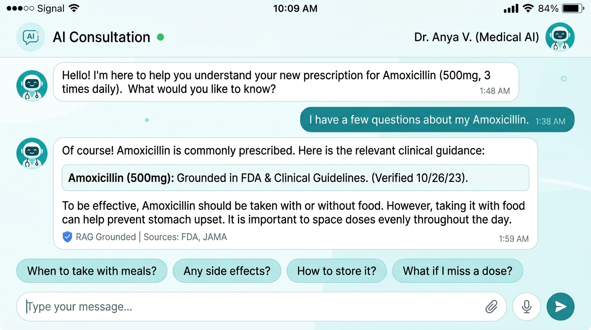
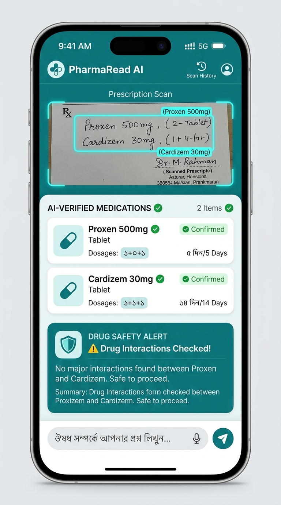

# 🩺 MedBangla AI (মেডবাংলা এআই)
### AI-Powered Bangla Prescription Understanding, Medication Safety & Clinical Decision Support System

[](https://github.com/didipta/medbangla-ai/actions/workflows/ci.yml)
[](https://github.com/didipta/medbangla-ai/actions/workflows/cd.yml)
[](LICENSE)
[](https://www.python.org/)
[](https://nextjs.org/)
[](https://fastapi.tiangolo.com/)
[](https://flutter.dev/)

> **Empowering patients and clinicians across Bangladesh** with bilingual prescription OCR, automatic drug-drug interaction alerts grounded in official DGDA clinical monographs, and accessible explanations in native Bengali.

---

## 🌐 Live Deployments & Capstone Deliverables

| Resource | Access Link | Description |
| :--- | :--- | :--- |
| 🚀 **Live Web Application** | [medbangla.vercel.app](https://medbangla.vercel.app) *(or your deployed Vercel domain)* | Interactive Next.js 16 web application with side-by-side verification canvas |
| ⚡ **Live API Documentation** | [medbangla-backend.onrender.com/docs](https://medbangla-backend.onrender.com/docs) | Interactive Swagger UI for FastAPI backend endpoints |
| 📑 **Capstone Final Report** | [CAPSTONE_FINAL_REPORT.md](CAPSTONE_FINAL_REPORT.md) | Comprehensive 5-page report (Problem, Architecture, AI Workflow, Evaluation & Conclusions) |
| 🏗️ **Master Architecture Spec** | [PROJECT_PLAN.md](PROJECT_PLAN.md) | In-depth engineering specifications & database schema |
| 📘 **Infrastructure & GPU Audit** | [MEDBANGLA_AI_SYSTEM_ARCHITECTURE_AND_INFRASTRUCTURE_REPORT.md](MEDBANGLA_AI_SYSTEM_ARCHITECTURE_AND_INFRASTRUCTURE_REPORT.md) | Detailed infrastructure, server sizing, and bilingual system blueprint |
| 🔄 **CI/CD Deployment Guide** | [CI_CD_GUIDE.md](CI_CD_GUIDE.md) | GitHub Actions, GHCR images, Render, and zero-downtime deployment |

---

## 🚨 Problem Statement & Solution

### The Challenge
- **Illegible Doctor Handwriting:** Over 70% of outpatient prescriptions in Bangladesh are handwritten in cursive, leading to misinterpretation, dispensing of incorrect strengths, and life-threatening medical errors.
- **Polypharmacy & Drug Interactions:** Comorbid patients frequently take 5–10 concurrent drugs. Without automated screening, contraindicated drug pairs go unnoticed.
- **Language Barrier:** Clinical monographs and package inserts are in English. Over 85% of citizens cannot decipher pharmacological instructions and forget verbal chamber advice.

### The MedBangla AI Solution
MedBangla AI creates a safety net by combining **OpenCV image preprocessing**, **RapidOCR (ONNX CPU)** with **Gemini Vision fallback**, **Levenshtein/Trigram fuzzy matching** across 17,589 DGDA-registered medicines, **pairwise Drug-Drug Interaction (DDI) screening**, and a **Bengali Clinical RAG assistant** with strict medical guardrails.

---

## 📸 User Interface & Visual Walkthrough

### 1. Interactive Prescription Verification & Side-by-Side Canvas
Upload or photograph any medical prescription. The system extracts text lines, predicts medicine names, and provides an interactive side-by-side verification canvas where users can review candidates.



---

### 2. Sourced Drug-Drug Interaction Screening
Detected medications are instantly cross-referenced against our clinical interaction matrix. Interactions are triaged into **CONTRAINDICATED**, **MAJOR**, **MODERATE**, or **MINOR** with citations to pharmacological literature.



---

### 3. Culturally Fluent Bengali Clinical RAG Assistant
Patients can ask questions about their prescribed medicines in plain Bengali. The assistant responds using official DGDA monographs, detailing indications, food interactions, and precautions without hallucinating diagnoses.



---

### 4. Cross-Platform Mobile Experience (Flutter App)
Field-tested for rural healthcare workers and patients on low-cost Android smartphones with hardware camera acceleration and offline DGDA directory access.



---

## 🎯 Step-by-Step Usage Instructions

```
[1. Upload Image] ──> [2. Review & Verify] ──> [3. Safety Triage] ──> [4. Bengali RAG Q&A]
```

1. **Step 1: Upload or Snap Prescription**
   - Click **"প্রেসক্রিপশন আপলোড করুন" (Upload Prescription)** on the web portal or tap the camera button in the Flutter mobile app.
   - Supported formats: `.jpg`, `.png`, `.webp`, `.pdf` up to 10MB.
2. **Step 2: Interactive Verification (Human-in-the-Loop)**
   - The AI identifies medicine names, dosage frequencies (e.g. `১+০+১`), and durations.
   - High-confidence matches ($\ge 85\%$) are pre-selected. For low-confidence cursive crops, tap to select from top DGDA candidate suggestions or manually edit.
3. **Step 3: Review Medication Safety & Interactions**
   - Click **"ড্রাগ ইন্টারঅ্যাকশন চেক করুন" (Check Safety)**.
   - If severe interactions exist (e.g., Ciprofloxacin + Antacid, or ACE inhibitor + Spironolactone), the system flags red warnings with clinical explanations and instructions to contact the prescribing doctor.
4. **Step 4: Ask Questions in Plain Bengali**
   - Use the embedded chat assistant: *"এই ওষুধটি খাওয়ার সঠিক নিয়ম কি?"* (What is the right way to take this?) or *"খাওয়ার আগে না পরে খাব?"* (Should I take this before or after meals?).
   - Receive verified, grounded advice in plain Bengali.

---

## 🧠 AI/ML Architecture & Methodology

```
                               ┌────────────────────────────────────────┐
                               │       Prescription Image Upload        │
                               └──────────────────┬─────────────────────┘
                                                  │
                                                  ▼
                               ┌────────────────────────────────────────┐
                               │   Stage 1: OpenCV Image Preprocessing  │
                               │   - Bilateral Denoising                │
                               │   - CLAHE Adaptive Contrast            │
                               │   - Deskew & Perspective Normalization │
                               └──────────────────┬─────────────────────┘
                                                  │
                                                  ▼
                               ┌────────────────────────────────────────┐
                               │   Stage 2: Hybrid Bilingual OCR Hub    │
                               │   - RapidOCR (ONNX CPU Runtime)        │
                               │   - Confidence Evaluation (< 75%)      │
                               │   - Multimodal Fallback (Gemini Flash) │
                               └──────────────────┬─────────────────────┘
                                                  │
                                                  ▼
                               ┌────────────────────────────────────────┐
                               │   Stage 3: Normalization & Fuzzy Match │
                               │   - Regex Dosage Extractor (1+0+1)     │
                               │   - PostgreSQL pg_trgm Trigram Search  │
                               │   - 17,589 DGDA Brand & Generic Catalog│
                               └──────────────────┬─────────────────────┘
                                                  │
                                                  ▼
                               ┌────────────────────────────────────────┐
                               │   Stage 4: Pairwise Interaction Engine │
                               │   - Severity Triage (CONTRAINDICATED)  │
                               │   - Evidence-Grounded Pharmacovigilance│
                               └──────────────────┬─────────────────────┘
                                                  │
                                                  ▼
                               ┌────────────────────────────────────────┐
                               │   Stage 5: Bengali Clinical RAG Engine │
                               │   - Dense Semantic Retrieval (pgvector)│
                               │   - Grounded LLM Context Synthesis     │
                               │   - Strict Hallucination Guardrails    │
                               └────────────────────────────────────────┘
```

### 1. Hybrid CPU-First Vision & OCR Hub
- **RapidOCR with ONNX Runtime:** Runs locally on standard CPU in **sub-second latency (250–850ms)**, recognizing printed English and Bengali text.
- **Multimodal Cloud Vision Fallback:** If confidence drops below 75% on handwritten cursive, the crop is routed to Google Gemini 2.0 Flash / Groq Qwen-27B Vision, keeping total processing cost at **1.29 BDT ($0.0105 USD)** per prescription.

### 2. Lexical & Trigram Entity Matching
- Custom regular expressions extract clinical dosing shorthand:
  - Patterns: `1+0+1`, `0+1+0`, `1 tab daily`, `খাওয়ার আগে`, `ভরা পেটে`.
- Postgres `pg_trgm` calculates trigram similarity against 17,589 DGDA brands and generics in $<18\text{ms}$:
$$\text{Similarity}(S_1, S_2) = \frac{|\text{Trigrams}(S_1) \cap \text{Trigrams}(S_2)|}{|\text{Trigrams}(S_1) \cup \text{Trigrams}(S_2)|}$$

### 3. Pairwise Drug-Drug Interaction (DDI) Matrix
- Sourced from British National Formulary (BNF), Stockley’s Drug Interactions, and DGDA alerts.
- Evaluates all pairs $O(n^2)$ instantly, flagging contraindications, adverse pharmacokinetic changes, and patient risk profiles.

### 4. Bengali Clinical RAG Engine & Guardrails
- **Chunked Vector Embeddings:** DGDA monographs indexed via `sentence-transformers` and stored in `pgvector`.
- **Hallucination Blocker:** LLM responses are strictly bounded by retrieved monograph context. The assistant never diagnoses diseases or alters prescribed doses.

---

## 💻 Tech Stack Matrix

| Layer | Technologies Used |
| :--- | :--- |
| **Web Frontend** | Next.js 16 (App Router), TypeScript, Tailwind CSS, Lucide React |
| **Mobile Frontend** | Flutter 3.x, Dart, Material 3, Camera & Gallery integrations |
| **Backend API** | FastAPI, Uvicorn, Pydantic v2, Python 3.11+, AsyncIO |
| **Database & Search** | PostgreSQL 16 (Neon Serverless), `pgvector`, `pg_trgm`, Alembic |
| **Computer Vision / OCR** | OpenCV (`opencv-python-headless`), RapidOCR (ONNX), PaddleOCR |
| **AI / LLM Providers** | Google Gemini 2.0/3.0 Flash, Groq Qwen-27B, SentenceTransformers |
| **DevOps & Containers** | Docker, Docker Compose, GitHub Actions (CI/CD), GHCR, Render, Vercel |

---

## 🛠️ Installation & Setup Instructions

### Option 1: Quickstart with Docker Compose (Recommended)

```bash
# 1. Clone the repository
git clone https://github.com/didipta/medbangla-ai.git
cd medbangla-ai

# 2. Setup environment variables
cp .env.example .env

# 3. Build and launch all services (Frontend, Backend, Database)
docker compose up --build -d
```

- **Web Frontend:** [http://localhost:3000](http://localhost:3000)
- **FastAPI Documentation:** [http://localhost:8000/docs](http://localhost:8000/docs)
- **Health Check Endpoint:** [http://localhost:8000/api/v1/health](http://localhost:8000/api/v1/health)

---

### Option 2: Manual Local Development Setup

#### Backend (FastAPI + Python 3.11)
```bash
cd backend

# Create and activate virtual environment
python -m venv venv
# On Windows:
.\venv\Scripts\activate
# On Linux/macOS:
source venv/bin/activate

# Install dependencies
pip install -r requirements.txt

# Configure environment
cp .env.example .env

# Run database migrations and seed DGDA medicine catalog
python scripts/seed_database.py

# Start FastAPI server
uvicorn app.main:app --host 0.0.0.0 --port 8000 --reload
```

#### Frontend (Next.js 16)
```bash
cd frontend

# Install Node dependencies
npm install

# Start Next.js development server
npm run dev
```
Open [http://localhost:3000](http://localhost:3000) in your browser.

#### Mobile Application (Flutter)
```bash
cd flutter_app

# Fetch Flutter dependencies
flutter pub get

# Run on connected device or emulator
flutter run
```

---

## 📂 Repository Structure

```
medbangla-ai/
├── CAPSTONE_FINAL_REPORT.md       # Academic Capstone Final Report (3-5 pages)
├── PROJECT_PLAN.md                # System Architecture & Technical Master Plan
├── CI_CD_GUIDE.md                 # Continuous Integration & Deployment Manual
├── RENDER_DEPLOY_AND_KEEP_ALIVE.md# Cloud hosting & keep-alive configuration
├── docker-compose.yml             # Root multi-container orchestration
├── render.yaml                    # Automated cloud deployment blueprint
│
├── backend/                       # FastAPI Python 3.11 Backend
│   ├── app/
│   │   ├── ai/
│   │   │   ├── ocr/               # RapidOCR ONNX, OpenCV deskewing, Vision AI
│   │   │   └── rag/               # Vector indexing, DDI screening, Bengali RAG
│   │   ├── api/v1/endpoints/      # REST routes (ocr, chat, interactions, rx, admin)
│   │   ├── core/                  # Security, JWT, config, database sessions
│   │   └── main.py                # ASGI application factory & middleware
│   ├── data/raw/                  # 17,589 DGDA medicine catalogs & CSV records
│   ├── Dockerfile                 # Production backend container definition
│   └── requirements.txt           # Python dependencies
│
├── frontend/                      # Next.js 16 Web Application
│   ├── app/                       # App router, pages, clinical components
│   ├── public/images/             # UI screenshots, banners, and feature graphics
│   ├── Dockerfile                 # Standalone production container definition
│   └── package.json               # Frontend dependencies & scripts
│
└── flutter_app/                   # Cross-Platform Flutter Mobile Application
    ├── lib/                       # Clean architecture (core, features, presentation)
    └── pubspec.yaml               # Flutter package dependencies
```

---

## 🔒 Ethical Guardrails & Clinical Disclaimer

> **IMPORTANT CLINICAL NOTICE:**  
> **MedBangla AI is strictly an informational and verification assistant.**  
> It is **not** a licensed medical doctor and does **not** provide clinical diagnoses, alter prescribed drug dosages, or recommend self-medication. Patients must always consult a registered healthcare practitioner or pharmacist before initiating or modifying any medication regimen.

---

## 📜 License & Acknowledgments

This project is open-source under the [MIT License](LICENSE).  
- Pharmacological data provided by the **Directorate General of Drug Administration (DGDA), Bangladesh**.
- Drug interaction taxonomy adapted from international clinical reference standards.
